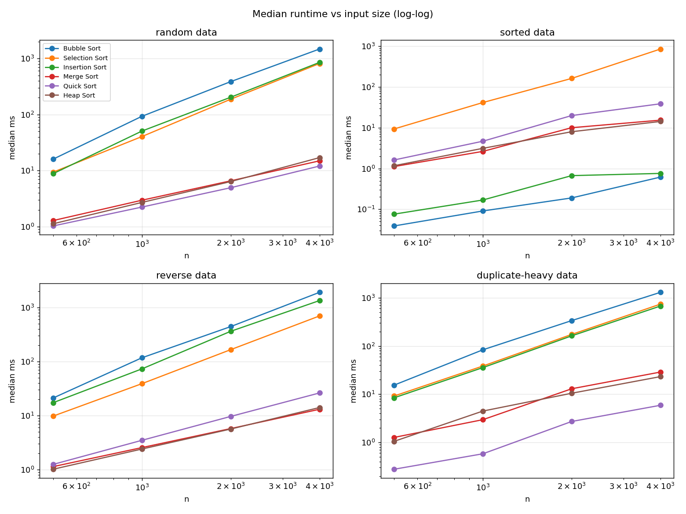

# Laboratory Activity No. 11 – Sorting Algorithms and Performance Benchmarks

CPEPRO8L – Data Structures and Algorithms · First Semester, AY 2026-2027

## Objectives
1. Implement Bubble, Selection, Insertion, Merge, Quick and Heap Sort without built-in sorting.
2. Verify correctness on normal, boundary, duplicate and reverse-order datasets.
3. Measure and compare runtime across input sizes and data distributions.
4. Relate measurements to expected time and space complexity.

## Environment
- Python 3.12 (3.11+ required); standard modules `random`, `time`, `statistics`, `unittest`, `csv`
- `matplotlib` is used **only** by `make_chart.py` to draw the chart (`pip install matplotlib`)
- Built-in `sorted()` is used only in `test_sorts.py` and as the reference check in `benchmark_sorts.py`, never inside the algorithms.

## How to run
```bash
python test_sorts.py          # correctness tests (must be clean first)
python benchmark_sorts.py     # writes benchmark_results.csv
python make_chart.py          # writes comparison_chart.png and results_table.md
```

## Design
**Test datasets (Task A):** empty, one item, two items, all duplicates, many duplicates, already sorted, reverse sorted, random, negatives, plus 100 random fuzz cases per algorithm, a check that the input list is not modified, and a stability check.

**Benchmark sizes:** n = 500, 1000, 2000, 4000. Conditions: random, sorted, reverse, duplicate-heavy (values 0–9).

**Fairness controls:**
- One source dataset per (size, condition), fixed seed (11), generated outside the timer.
- Every algorithm and trial sorts a fresh copy of the same data.
- 5 timed trials per algorithm/condition/size; **median** reported; `time.perf_counter()` around the sort call only.
- Every output is checked against the reference sort.
- Counters (comparisons, moves) are on in all runs, so all algorithms carry the same overhead. A swap counts as 2 moves.
- Skip rule: a quadratic algorithm is skipped at a larger size only if its previous median exceeded 5 s. **No runs were skipped** (largest quadratic median was 1.9 s).

**Quick Sort pivot strategy:** median of first/middle/last item, three-way (Dutch-flag) partition, recursing into the smaller side and looping on the larger.

**Auxiliary space:** Bubble/Selection/Insertion/Heap O(1); Quick Sort O(log n) stack; Merge Sort O(n) buffer.

## Test result
`test_output.txt`: all 3 test groups pass (every algorithm × every dataset, fuzz, stability).

## Results (median runtime, ms; full data in `benchmark_results.csv`)

**random**

| Algorithm | n=500 | n=1000 | n=2000 | n=4000 |
|---|---:|---:|---:|---:|
| Bubble | 15.99 | 93.08 | 386.99 | 1477.42 |
| Selection | 9.37 | 40.51 | 187.74 | 814.79 |
| Insertion | 8.81 | 50.75 | 203.92 | 852.71 |
| Merge | 1.28 | 2.96 | 6.57 | 14.94 |
| Quick | 1.03 | 2.23 | 4.95 | 12.06 |
| Heap | 1.12 | 2.70 | 6.38 | 17.05 |

**sorted**

| Algorithm | n=500 | n=1000 | n=2000 | n=4000 |
|---|---:|---:|---:|---:|
| Bubble | 0.04 | 0.09 | 0.19 | 0.62 |
| Selection | 9.35 | 41.61 | 162.67 | 855.88 |
| Insertion | 0.08 | 0.17 | 0.67 | 0.76 |
| Merge | 1.12 | 2.63 | 10.04 | 15.38 |
| Quick | 1.62 | 4.68 | 19.94 | 38.79 |
| Heap | 1.17 | 3.13 | 8.00 | 14.29 |

**reverse**

| Algorithm | n=500 | n=1000 | n=2000 | n=4000 |
|---|---:|---:|---:|---:|
| Bubble | 21.13 | 117.23 | 442.55 | 1904.79 |
| Selection | 9.78 | 38.95 | 165.79 | 696.43 |
| Insertion | 17.31 | 73.09 | 362.25 | 1340.62 |
| Merge | 1.14 | 2.56 | 5.75 | 13.09 |
| Quick | 1.25 | 3.49 | 9.66 | 26.23 |
| Heap | 1.02 | 2.41 | 5.64 | 14.10 |

**duplicate-heavy**

| Algorithm | n=500 | n=1000 | n=2000 | n=4000 |
|---|---:|---:|---:|---:|
| Bubble | 15.41 | 83.44 | 336.91 | 1302.20 |
| Selection | 9.16 | 38.44 | 174.07 | 741.59 |
| Insertion | 8.42 | 35.66 | 162.54 | 676.76 |
| Merge | 1.27 | 2.96 | 12.97 | 28.83 |
| Quick | 0.28 | 0.58 | 2.72 | 5.89 |
| Heap | 1.05 | 4.47 | 10.47 | 23.19 |

**Comparison / move counts at n = 4000**

| Algorithm | random cmp / moves | sorted cmp / moves | reverse cmp / moves |
|---|---|---|---|
| Bubble | 7,994,760 / 7,925,520 | 3,999 / 0 | 7,998,000 / 15,996,000 |
| Selection | 7,998,000 / 7,980 | 7,998,000 / 0 | 7,998,000 / 4,000 |
| Insertion | 3,966,755 / 3,966,759 | 3,999 / 3,999 | 7,998,000 / 8,001,999 |
| Merge | 42,740 / 95,808 | 23,728 / 95,808 | 24,176 / 95,808 |
| Quick | 80,612 / 94,340 | 294,255 / 295,156 | 219,082 / 221,166 |
| Heap | 83,443 / 88,690 | 86,576 / 94,284 | 80,151 / 82,872 |

## Chart


## Guide questions
1. **Which elementary algorithm benefited most from sorted data?** Bubble Sort (0.62 ms at n=4000) and Insertion Sort (0.76 ms) both dropped from ~1 s to under 1 ms: with early exit Bubble does one pass (3,999 comparisons), and Insertion finds each item already in place with one comparison. Selection Sort gained nothing (855 ms) because it always scans the whole unsorted part (7,998,000 comparisons).
2. **How did the Quick Sort pivot strategy affect sorted/duplicate-heavy data?** Median-of-three avoids the O(n²) collapse a first/last pivot has on sorted/reverse input, and three-way partitioning makes duplicate-heavy data the *fastest* case (5.89 ms at n=4000 vs 12.06 ms random), since equal keys are removed from recursion. However, sorted data was still ~3× slower than random (38.8 vs 12.1 ms) – see Q6.
3. **Why median over a single timing?** One run can be inflated by OS scheduling, garbage collection or caching. The median of several trials ignores such outliers and is more repeatable than a single value or a mean.
4. **Merge Sort's memory trade-off?** It needs O(n) extra space (our single buffer) to merge, buying guaranteed O(n log n) time and stability. Heap, Quick (O(log n) stack) and the elementary sorts are in place, but give up stability (Heap, Quick, Selection) or the worst-case guarantee (Quick).
5. **When is an O(n²) algorithm reasonable?** For small n (tens of items), nearly sorted data (Insertion/Bubble run in O(n)), when code simplicity or O(1) memory matters, or when swaps must be minimal (Selection does only n−1 swaps). Our n=500 runs took under 25 ms.
6. **Biggest difference from theory?** Quick Sort on sorted data: theory suggests it should behave like random data (balanced median pivot, ~n log n), but it used 294,255 comparisons vs 80,612 for random (3.6×) and ran ~3× slower. Likely cause: the three-way partition swaps elements from the far end and scrambles the sub-ranges, so later median-of-three pivots are less balanced, and it also makes two comparisons per item. I did not run a recursion-depth trace to confirm this. A smaller discrepancy: Merge Sort was ~2× slower on duplicate-heavy than random at n=4000 (28.8 vs 14.9 ms) although its comparison and move counts were nearly identical, which points to timing noise on the workstation rather than algorithmic behaviour.

## Conclusion
The six algorithms pass all correctness tests. Measurements agree with theory: the quadratic sorts grow ~4× per doubling of n (e.g., Bubble random 93 → 387 → 1477 ms) while Merge, Quick and Heap grow only slightly more than 2×, and are 50–100× faster at n=4000. Input order matters a lot for Bubble/Insertion (O(n) on sorted data) and not at all for Selection and Heap. Quick Sort was the fastest on random and duplicate-heavy data, Merge and Heap were the most consistent, and Quick Sort's sorted-data result showed that implementation details (partitioning scheme) can matter as much as asymptotic class.

## Files submitted
| File | Purpose |
|---|---|
| `sorting_algorithms.py` | Six algorithms with comparison/move counters |
| `test_sorts.py` | Correctness, fuzz and stability tests |
| `benchmark_sorts.py` | Controlled benchmark |
| `make_chart.py` | Builds chart and table from CSV |
| `benchmark_results.csv` | Raw results |
| `comparison_chart.png` | Runtime growth chart |
| `results_table.md`, `test_output.txt` | Generated table and test log |
| `README.md` | This report |

> Note: timings are from my workstation and will differ on yours; regenerate with the commands above.
