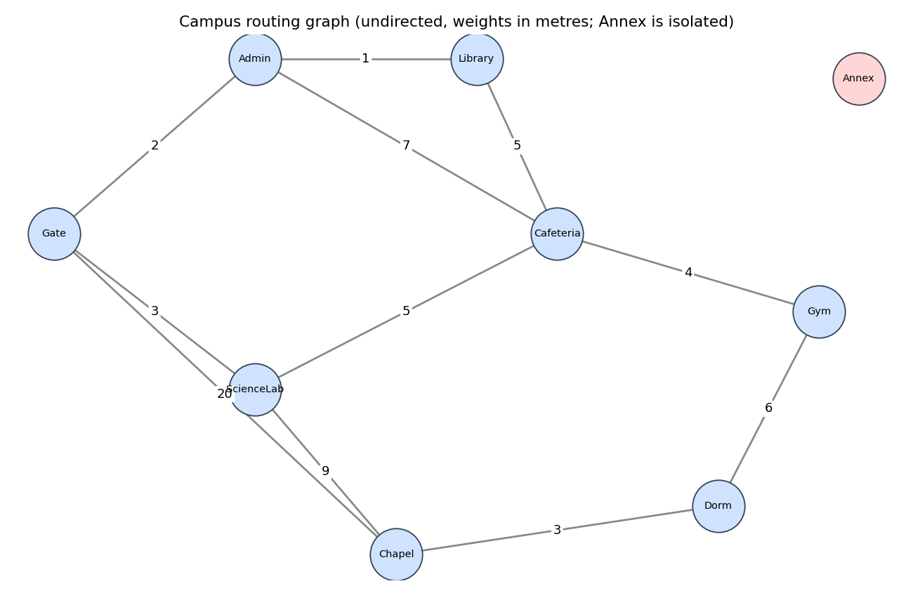

# Laboratory Activity No. 12 – Graph Traversals and Shortest-Path Routing

CPEPRO8L – Data Structures and Algorithms · First Semester, AY 2026-2027

> **Dataset note:** no instructor graph was attached, so I used a campus-routing scenario of my own (`campus_edges.csv`). It is undirected and weighted in metres, and it includes a cycle, equal-cost routes, an isolated vertex and a "direct but long" edge. To use the instructor's dataset, replace the CSV (same columns) and rerun; the hand-derived expected values in `test_graph.py` and `hand_traces.md` would then need redoing.

## Objectives
1. Represent unweighted and weighted graphs using adjacency lists.
2. Implement and trace BFS and DFS.
3. Implement Dijkstra's algorithm with a priority queue (`heapq`).
4. Verify results with hand traces and independent tests.

## Environment
- Python 3.12 (3.11+ required); standard modules `collections`, `heapq`, `math`, `csv`, `unittest`
- `matplotlib` only for drawing `graph_diagram.png` in `run_demo.py` (`pip install matplotlib`)

## Execution commands
```bash
python test_graph.py   # 21 expected/observed cases (unittest)
python run_demo.py     # regenerates tables, traces, routing results and the diagram
```

## Design decisions
- **Graph model (`graph.py`):** dict-of-dicts adjacency list, `directed` and `weighted` flags, duplicate-edge and non-numeric-weight rejection, CSV loader, and an independent `verify_against_csv` check (every vertex and edge appears with the right weight).
- **Ordering rule:** neighbors are always processed **alphabetically**, so BFS/DFS orders are deterministic.
- **Dijkstra:** `heapq` with `(distance, vertex)` entries, lazy deletion plus a settled set, predecessor map, strict `<` updates (first shortest path found wins). Negative weights raise `NegativeWeightError`.

## Graph (edge table and diagram)
| # | From | To | Weight (m) |
|---:|---|---|---:|
| 1 | Admin | Cafeteria | 7 |
| 2 | Admin | Gate | 2 |
| 3 | Admin | Library | 1 |
| 4 | Cafeteria | Gym | 4 |
| 5 | Cafeteria | Library | 5 |
| 6 | Cafeteria | ScienceLab | 5 |
| 7 | Chapel | Dorm | 3 |
| 8 | Chapel | Gate | 20 |
| 9 | Chapel | ScienceLab | 9 |
| 10 | Dorm | Gym | 6 |
| 11 | Gate | ScienceLab | 3 |

Isolated vertices: Annex



## Traversal results (two start vertices)
```
BFS from Gate: Gate -> Admin -> Chapel -> ScienceLab -> Cafeteria -> Library -> Dorm -> Gym
DFS from Gate: Gate -> Admin -> Cafeteria -> Gym -> Dorm -> Chapel -> ScienceLab -> Library
BFS from Dorm: Dorm -> Chapel -> Gym -> Gate -> ScienceLab -> Cafeteria -> Admin -> Library
DFS from Dorm: Dorm -> Chapel -> Gate -> Admin -> Cafeteria -> Gym -> Library -> ScienceLab
```
Full hand traces (queue/stack state, selected vertex, visited set, order) are in `hand_traces.md`. They were worked out before running the code and the program output matched on the first run, so no corrections were needed. The program's own traces are in `traversal_results.txt`.

## Shortest-path results (Dijkstra from Gate)
Source: Gate

| Target | Distance (m) | Shortest path | Edges |
|---|---:|---|---:|
| Admin | 2 | Gate > Admin | 1 |
| Annex | unreachable | - | - |
| Cafeteria | 8 | Gate > Admin > Library > Cafeteria | 3 |
| Chapel | 12 | Gate > ScienceLab > Chapel | 2 |
| Dorm | 15 | Gate > ScienceLab > Chapel > Dorm | 3 |
| Gate | 0 | Gate | 0 |
| Gym | 12 | Gate > Admin > Library > Cafeteria > Gym | 4 |
| Library | 3 | Gate > Admin > Library | 2 |
| ScienceLab | 3 | Gate > ScienceLab | 1 |

**BFS tree vs shortest-path tree (from Gate)**

| Target | BFS path (min edges) | BFS cost | Dijkstra path | Dijkstra cost |
|---|---|---:|---|---:|
| Admin | Gate > Admin | 2 | Gate > Admin | 2 |
| Cafeteria | Gate > Admin > Cafeteria | 9 | Gate > Admin > Library > Cafeteria | 8 |
| Chapel | Gate > Chapel | 20 | Gate > ScienceLab > Chapel | 12 |
| Dorm | Gate > Chapel > Dorm | 23 | Gate > ScienceLab > Chapel > Dorm | 15 |
| Gym | Gate > Admin > Cafeteria > Gym | 13 | Gate > Admin > Library > Cafeteria > Gym | 12 |
| Library | Gate > Admin > Library | 3 | Gate > Admin > Library | 3 |
| ScienceLab | Gate > ScienceLab | 3 | Gate > ScienceLab | 3 |

Manual verification (full sums in `hand_traces.md`): Gate→Dorm = 3+9+3 = 15 m; Gate→Cafeteria = 2+1+5 = 8 m (equal-cost alternative via ScienceLab is also 8 m); Gate→Chapel = 3+9 = 12 m, beating the direct 20 m edge.

**Rejected / unsupported cases** (`rejected_cases.txt`):
```
dijkstra(neg, 'A') -> NegativeWeightError: graph has a negative edge weight; Dijkstra's algorithm is not valid
Unchecked Dijkstra A->B = 4; true shortest (Bellman-Ford) = 2 (A>C>B = 5 + -3)
bfs(g, 'Nope') -> KeyError: "unknown start vertex 'Nope'"
```
Negative weights are invalid because Dijkstra permanently fixes a vertex's distance when it is popped, assuming no later route can be shorter. A negative edge can make a later route shorter, so the fixed answer is wrong (4 instead of 2 above).

## Expected vs observed tests
| # | Test | Expected | Observed | Status |
|---:|---|---|---|---|
| 1 | Graph has 9 vertices / 11 edges | (9, 11) | (9, 11) | PASS |
| 2 | Structure matches source CSV | [] | [] | PASS |
| 3 | BFS from Gate | ['Gate', 'Admin', 'Chapel', 'ScienceLab', 'Cafeteria', 'Library', 'Dorm', 'Gym'] | ['Gate', 'Admin', 'Chapel', 'ScienceLab', 'Cafeteria', 'Library', 'Dorm', 'Gym'] | PASS |
| 4 | DFS from Gate | ['Gate', 'Admin', 'Cafeteria', 'Gym', 'Dorm', 'Chapel', 'ScienceLab', 'Library'] | ['Gate', 'Admin', 'Cafeteria', 'Gym', 'Dorm', 'Chapel', 'ScienceLab', 'Library'] | PASS |
| 5 | BFS from Dorm | ['Dorm', 'Chapel', 'Gym', 'Gate', 'ScienceLab', 'Cafeteria', 'Admin', 'Library'] | ['Dorm', 'Chapel', 'Gym', 'Gate', 'ScienceLab', 'Cafeteria', 'Admin', 'Library'] | PASS |
| 6 | DFS from Dorm | ['Dorm', 'Chapel', 'Gate', 'Admin', 'Cafeteria', 'Gym', 'Library', 'ScienceLab'] | ['Dorm', 'Chapel', 'Gate', 'Admin', 'Cafeteria', 'Gym', 'Library', 'ScienceLab'] | PASS |
| 7 | Recursive DFS == explicit-stack DFS (Gate) | ['Gate', 'Admin', 'Cafeteria', 'Gym', 'Dorm', 'Chapel', 'ScienceLab', 'Library'] | ['Gate', 'Admin', 'Cafeteria', 'Gym', 'Dorm', 'Chapel', 'ScienceLab', 'Library'] | PASS |
| 8 | Dijkstra distances from Gate | {'Admin': 2, 'Annex': inf, 'Cafeteria': 8, 'Chapel': 12, 'Dorm': 15, 'Gate': 0, 'Gym': 12, 'Library': 3, 'ScienceLab': 3} | {'Admin': 2, 'Annex': inf, 'Cafeteria': 8, 'Chapel': 12, 'Dorm': 15, 'Gate': 0, 'Gym': 12, 'Library': 3, 'ScienceLab': 3} | PASS |
| 9 | Path Gate->Dorm (cost 3+9+3=15) | (['Gate', 'ScienceLab', 'Chapel', 'Dorm'], 15) | (['Gate', 'ScienceLab', 'Chapel', 'Dorm'], 15) | PASS |
| 10 | Path Gate->Cafeteria (cost 2+1+5=8) | (['Gate', 'Admin', 'Library', 'Cafeteria'], 8) | (['Gate', 'Admin', 'Library', 'Cafeteria'], 8) | PASS |
| 11 | Equal-cost alternative Gate-ScienceLab-Cafeteria also costs 8 | 8 | 8 | PASS |
| 12 | Unreachable target Annex (dist inf, no path) | (inf, None) | (inf, None) | PASS |
| 13 | Isolated vertex Annex: BFS and DFS visit only itself | (['Annex'], ['Annex']) | (['Annex'], ['Annex']) | PASS |
| 14 | Cycle A-B-C: BFS/DFS terminate, each vertex once | (['A', 'B', 'C'], ['A', 'B', 'C']) | (['A', 'B', 'C'], ['A', 'B', 'C']) | PASS |
| 15 | Negative weight rejected by Dijkstra | NegativeWeightError | NegativeWeightError | PASS |
| 16 | Why negative is invalid: unchecked Dijkstra says A->B=4, true value 2 | (4, 2) | (4, 2) | PASS |
| 17 | Directed edge X->Y: Y cannot reach X | (['X', 'Y'], ['Y']) | (['X', 'Y'], ['Y']) | PASS |
| 18 | BFS tree (1 edge, weight 20) differs from shortest-path tree (2 edges, weight 12) | (['Gate', 'Chapel'], ['Gate', 'ScienceLab', 'Chapel']) | (['Gate', 'Chapel'], ['Gate', 'ScienceLab', 'Chapel']) | PASS |
| 19 | Unknown start vertex raises KeyError | ('KeyError', 'KeyError') | ('KeyError', 'KeyError') | PASS |
| 20 | Non-numeric weight rejected | TypeError | TypeError | PASS |
| 21 | Dijkstra == Bellman-Ford from every source vertex | True | True | PASS |

21/21 passed

## Complexity (V vertices, E edges, adjacency-list representation)
| Algorithm | Time | Space |
|---|---|---|
| BFS | O(V + E) | O(V) queue and visited |
| DFS | O(V + E) | O(V) visited plus recursion/stack depth |
| Dijkstra (binary heap, lazy deletion) | O((V + E) log V) | O(V + E) (heap can hold up to E entries) |

## Which algorithm to use
- **Unweighted reachability:** BFS or DFS (either visits everything reachable in O(V + E)).
- **Minimum number of edges:** BFS.
- **Weighted routing (non-negative weights):** Dijkstra. Negative weights would need Bellman-Ford.

## Guide questions
1. **Queue vs stack:** BFS's FIFO queue finishes all vertices at distance *k* before any at *k+1*, so it spreads outward level by level (Gate's three neighbors first). DFS's LIFO stack (or recursion) takes the most recently discovered vertex, so it follows one branch deep (Gate→Admin→Cafeteria→Gym→Dorm…) before backtracking.
2. **Why define neighbor order:** a vertex with several unvisited neighbors can be expanded in any order, and each order gives a different but valid traversal. Without a fixed rule (alphabetical here) results cannot be compared with a hand trace.
3. **When BFS gives a shortest path:** when edges are unweighted (or all equal weight). It minimizes the number of edges, not total distance: Gate→Chapel is 1 edge but 20 m, while the shortest route is 2 edges and 12 m.
4. **Negative weights:** Dijkstra finalizes a vertex when popped, assuming later paths can only add cost. A negative edge breaks that. In the example the unchecked version gave A→B = 4 while A→C→B = 2.
5. **Predecessors:** they let you rebuild the actual route for every target by walking back from the target, rather than only knowing the distance. They also make hand verification by summing edge weights possible and give the shortest-path tree.
6. **Adjacency lists and complexity:** each vertex's neighbors are scanned once, so every edge is examined a constant number of times, giving O(V + E) for BFS/DFS and O((V + E) log V) for Dijkstra. An adjacency matrix would make the scan O(V²).
7. **Strongest evidence of correctness:** the cross-check where Dijkstra's distances equal an independent Bellman-Ford implementation from *every* source vertex (test 21), together with the hand-derived expected values (computed before running) matching the program on the first run. The unreachable-Annex and equal-cost tests cover the edge cases.

## Conclusion
All 21 test cases pass. BFS and DFS give verified, deterministic orders from two start vertices; Dijkstra returns correct distances and reconstructed paths, reports the isolated Annex as unreachable, and rejects negative weights. The BFS tree differs from the shortest-path tree for 4 of 7 reachable targets (Cafeteria, Chapel, Dorm, Gym) — fewest edges and least distance are different objectives. Limitation: one small hand-built graph, so these tests show correctness but not performance on large graphs.

## Files submitted
| File | Purpose |
|---|---|
| `graph.py` | Adjacency-list graph, CSV loader, verification |
| `traversals.py` | BFS, recursive DFS, traces |
| `dijkstra.py` | Dijkstra, path reconstruction, negative-weight check |
| `test_graph.py` | Expected/observed tests |
| `run_demo.py` | Generates all outputs below |
| `campus_edges.csv` | Source graph data |
| `edge_table.md`, `graph_diagram.png` | Edge table and labeled diagram |
| `hand_traces.md` | Hand traces for BFS, DFS, Dijkstra |
| `traversal_results.txt`, `routing_table.md`, `routing_table.csv` | Program output |
| `test_results.md`, `rejected_cases.txt` | Test table and invalid-input evidence |
| `README.md` | This report |
